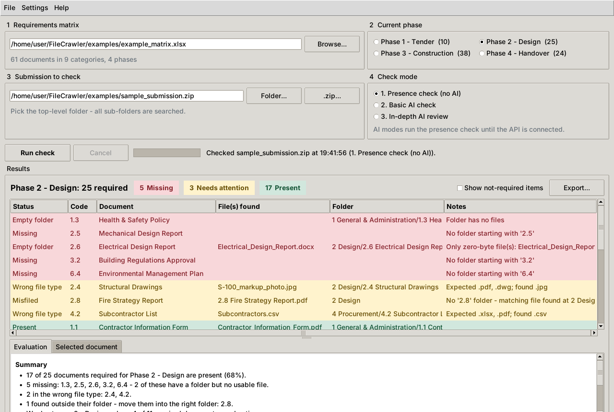

# FileCrawler

Checks a contractor's document submission against a **requirements matrix**: for the phase you select it
works out which required documents are missing, which are present but need fixing, and which are present.



## Quick start

```bash
pip install -r requirements.txt      # openpyxl, for .xlsx matrices
python -m filecrawler                 # opens the window (or double-click run_filecrawler.pyw on Windows)
```

In the window: **Help → Load example matrix + submission**, then **Run check**.

1. **Requirements matrix**: load the `.xlsx` or `.csv`.
2. **Current phase**: one radio button per phase column in the matrix (the number is how many documents it requires).
3. **Submission**: the top-level folder (all sub-folders are searched) or a `.zip`.
4. **Check mode**: 1 = presence check. Modes 2 and 3 run the presence check and then hand over to the AI hooks (not connected yet, see below).

Double-click a result to open its folder. **Export** writes the results to `.xlsx` (colour-coded, with a summary sheet) or `.csv`.

Linux needs Tk installed separately: `sudo apt install python3-tk`. Python 3.8+.

### Command line

```bash
python -m filecrawler --matrix examples/example_matrix.xlsx --phase design \
    --source examples/sample_submission.zip --export results.xlsx
```

`--phase` accepts the full column name or any unique part of it. Exit code: `0` all present, `1` something missing
or needing attention, `2` couldn't run. That makes it usable in scripts and scheduled jobs.

## The matrix

See `examples/example_matrix.xlsx` (and the same data in `example_matrix.csv`). Categories have different
numbers of documents (1.1-1.4, 2.1-2.11, ...).

| Code | Title | Allowed Types | Phase 1 - Tender | Phase 2 - Design | ... |
|------|-------|---------------|:---:|:---:|---|
| 2 | Design | | | | ← category heading (no dot, no marks) |
| 2.1 | Design Basis Report | .pdf; .docx | Y | Y | |
| 2.10 | Design Risk Register | .xlsx; .pdf | | Y | |

* **Code** (required): a numeric code. **In Excel, format this column as Text.** If it's stored as a number,
  `2.10` becomes `2.1`. The loader rejects the duplicate this creates and tells you why.
* **Title** (optional): shown in the results.
* **Allowed Types** (optional): e.g. `.pdf; .docx`. Blank means any type, unless a rule in Settings covers that code.
* **Phase columns**: any other column. `Y`, `Yes`, `X`, `R`, `M`, `1` mean required. Blank, `N`, `No`, `-`, `0` and `Optional` mean not required.
  A column of free text (e.g. "Revision") is skipped with a warning, and so are `Notes`, `Comments` and `Owner`.
* The header row is found automatically, so title or banner rows above it are fine. If the workbook has a sheet called
  `Matrix`, that sheet is used.

## How folders are matched

* Any folder, **at any depth**, whose name **starts with** a code belongs to that code:
  `2 Design/2.10 Design Risk Register/` → 2.10.
* Codes are compared as numbers, part by part: `2.10` never matches 2.1, and `02.01 Basis` matches 2.1.
* Files in sub-folders count (`2.2 Drawings/Rev C/A-100.pdf` → 2.2).
* Ignored by default: `Thumbs.db`, `desktop.ini`, `.DS_Store`, Office lock files (`~$*`), `*.tmp`, `__MACOSX`.
  A folder holding only these counts as empty.
* Zero-byte files count as missing (this can be switched off in Settings).

| Status | Group | Meaning |
|---|---|---|
| Missing | 🟥 Missing | No folder for the code |
| Empty folder | 🟥 Missing | Folder exists but has no usable file (empty, zero-byte or junk only) |
| Wrong file type | 🟨 Needs attention | Files present, none of an allowed type |
| Misfiled | 🟨 Needs attention | Nothing in its folder, but a file named with the code is elsewhere (e.g. `2 Design/2.8 Fire Strategy.pdf`) |
| Needs changes | 🟨 Needs attention | *(AI modes)* AI found blank or incorrect content |
| Present | 🟩 Present | A usable file exists. **Contents not checked.** |
| Present - OK | 🟩 Present | *(AI modes)* AI found it complete |
| Not required | ⬜ | Not required this phase. Hidden unless "Show not-required items" is ticked |

The Evaluation panel always shows a rule-based summary: completion %, missing codes, the weakest category,
documents provided early, and folders that don't match any code. The AI evaluation goes below it once connected.

## Settings

**Settings** menu, saved per user (`%APPDATA%\FileCrawler\settings.json` on Windows, `~/.config/filecrawler/` elsewhere):

* **Required file types by code**: `2 = .pdf` (whole category) or `2.2 = .pdf, .dwg` (one code). The most specific rule
  wins. These only apply where the matrix's Allowed Types cell is blank: the matrix is the source of truth
  because it travels with the project, while settings stay on one PC.
* Ignored file patterns and folder names (e.g. add `Superseded` or `Archive`).
* Whether zero-byte files count as missing.

## Connecting the AI (modes 2 and 3)

Everything goes through `filecrawler/ai_client.py`. The request code is written but commented out:

1. Implement `_post()` for your internal API (or swap in its SDK).
2. Uncomment the bodies of `check_completeness()` (mode 2), `review_content()` (mode 3) and `summarize()`,
   and map the response fields onto `AIVerdict(complete, findings)` / a list of bullet strings.
3. Make `configured` return `True`. URL and key come from the `FILECRAWLER_AI_URL` / `FILECRAWLER_AI_KEY`
   environment variables, which keeps credentials out of the repo.

The checker already handles the rest. Only required documents that passed the presence check are sent, each file is
checked, the result becomes **Present - OK** or **Needs changes** with findings, and failures are noted per document
without stopping the run. Suggested prompts are in `ai_client.py`. `tests/test_checker.py::FakeAI` shows the contract.
Zip submissions are presence-checked only in AI modes for now (they'd need extracting first).

## Project layout

```
filecrawler/
  matrix.py      load + validate the matrix (.xlsx/.csv)
  crawler.py     list a folder or .zip (long Windows paths, junk filtering, cancellable)
  checker.py     match folders/files to codes, decide statuses, run the AI pass
  report.py      ordering, rule-based summary, Excel/CSV export
  ai_client.py   AI hooks (stubbed)
  settings.py    persisted user settings
  gui.py         Tkinter window
  __main__.py    GUI / command-line entry point
examples/        example matrix (.xlsx/.csv), sample submission (.zip), make_examples.py to regenerate them
tests/           pytest suite. Run `pytest` (GUI test runs where a display is available: `xvfb-run pytest` on Linux CI)
```

`python examples/make_examples.py --folder <dir>` also unpacks the sample submission as a real folder tree.

## Known limitations

* Folder names must **start** with the code. `Section 2.10 - Risk Register` won't match.
* "Present" in mode 1 only means a non-empty file of an allowed type exists. It says nothing about the contents.
* `.xls` (pre-2007 Excel) isn't supported. Re-save as `.xlsx`.
